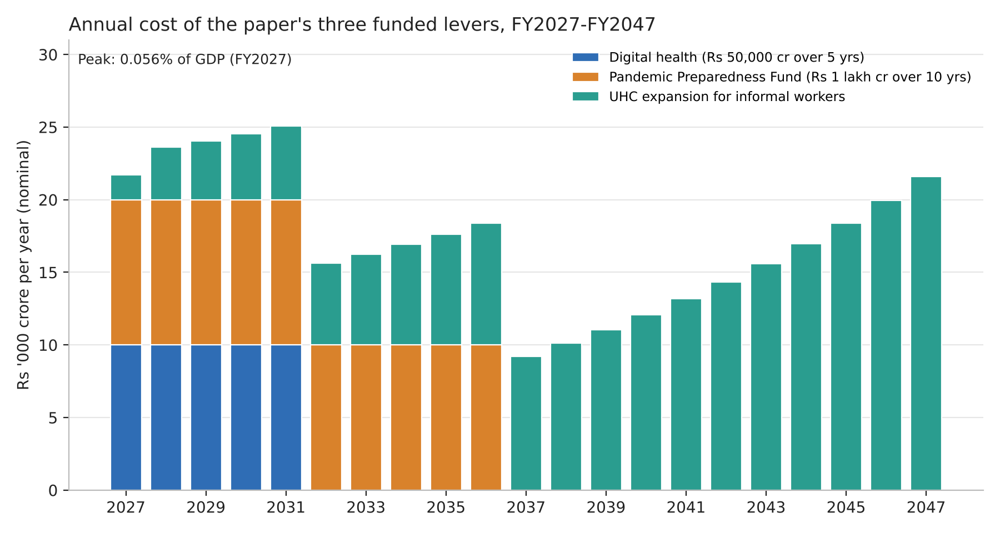
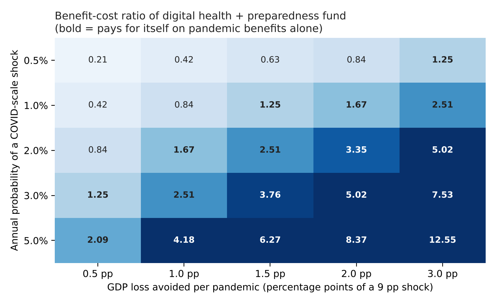
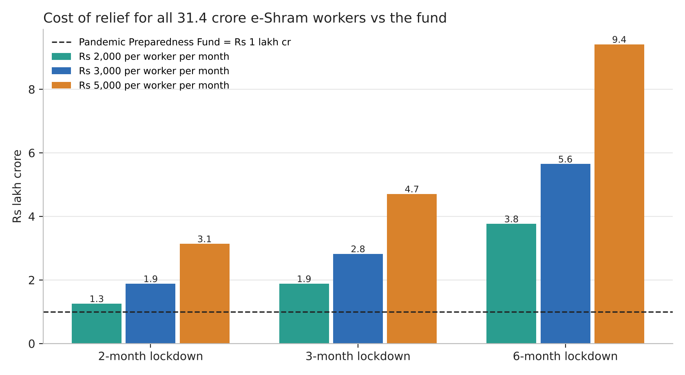
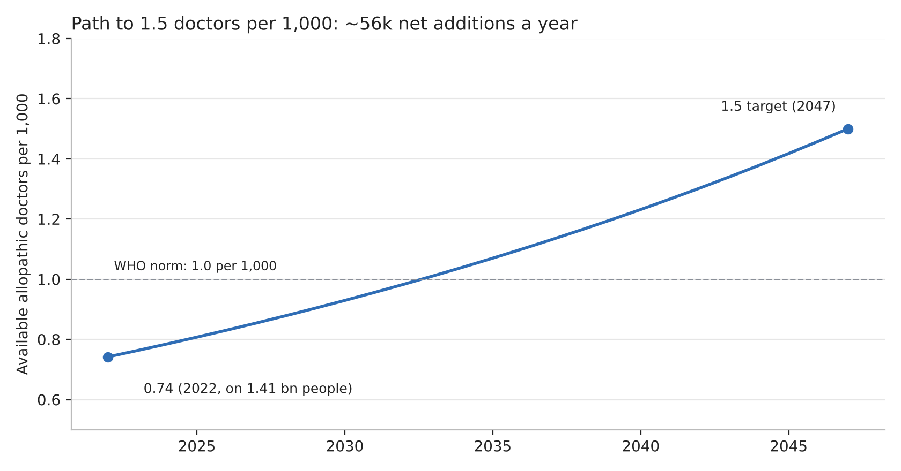

# India's Health–Growth Dilemma: A Quantified Policy Analysis

A policy paper and deck on building a **National Health–Economic Resilience Policy** for India (2030 and beyond), plus a reproducible Python model that puts numbers on its claims, fact-checks its baselines and tests where it is weakest.

**Author:** Priscilla
*Parts of the original paper and of this analysis were prepared with AI assistance (Claude).*

## Headline findings

| # | Finding | Number |
|---|---|---|
| 1 | The paper's three funded levers are **cheap relative to the economy** | ₹21,700 cr in FY2027 = **0.056% of GDP**; ₹3.66 lakh cr cumulative to FY2047 |
| 2 | The pandemic-specific spend **breaks even under modest assumptions** | At a 2%/yr shock probability, digital health + fund pay back if they avoid just **0.6 pp** of a 9 pp GDP shock |
| 3 | The ₹1 lakh cr fund is **too small for the relief role** the paper gives it | Covers **~1 month** of ₹3,000 support for 31.4 crore e-Shram workers |
| 4 | "Up to 40% lower out-of-pocket costs" **implies ~0.6% of GDP** in extra public spend | Evidence from PM-JAY supports **21%**, which is 0.32% of GDP |
| 5 | The 1.5 doctors/1,000 target is **modest nationally**; distribution is the real gap | ~56,000 net new doctors a year; baseline is 0.74/1,000, not the 0.84 implied by official figures |
| 6 | **Five headline baselines in the original needed correcting** | e.g. OOP share is 39.4%, not 70%; COVID GDP hit was −7.3%/−6.6%, not −9% |

## Charts

| | |
|---|---|
|  |  |
|  |  |

## Method in brief

- **Baselines** come from the National Health Accounts 2021-22, MoSPI GDP releases, the Ministry of Labour (e-Shram), PM-JAY reporting and a PHFI study. Each is tagged **V** (verified) in the register.
- **Costing** schedules the paper's ₹50,000 cr digital health, ₹1 lakh cr fund and UHC expansion (48% → 70% → 100% of e-Shram workers) against a GDP path derived from NHA ratios.
- **Benefit-cost** is a *break-even* analysis rather than a point forecast, because shock probability and damage avoided are genuinely uncertain.
- **Assumptions** I had to make are tagged **A** and swept where they matter. Read the limitations in the [annex](docs/QUANTIFIED_ANNEX.md#limitations) before quoting any number.

## Caveats

This is an illustrative planning model, not an official costing or a forecast. Recurrent costs, the supply-chain mandate, workforce expansion and climate adaptation are not costed, so the cost figures are a floor.

## Sources

See the [annex](docs/QUANTIFIED_ANNEX.md#sources) for linked sources.
